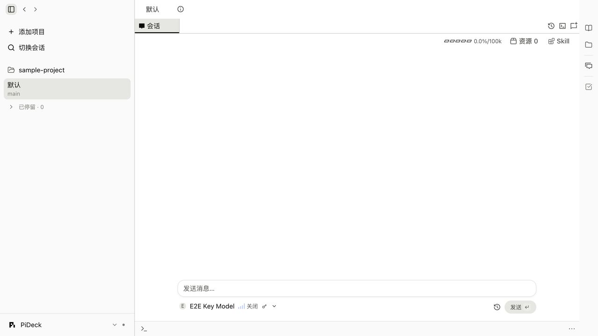

# PiDeck

**An agentic development workbench powered by Pi.**

English · [简体中文](README.zh-CN.md)

PiDeck brings coding conversations, Git worktrees, files, terminals and code review into one desktop
workbench. It is an independently maintained fork of [ThinkRail](https://github.com/JetBrains/thinkrail),
with [Pi](https://github.com/earendil-works/pi) running in-process as its agent engine.

The fork starts from **ThinkRail `main`** (`6cd6f905`), with Pi **1.4.0**. PiDeck is currently
intended for development and local builds. The pinned upstream commit identifies the source baseline;
it is not a PiDeck release. Signing, notarization and a PiDeck automatic-update service are not configured.

## What you can do

- **Work across projects and worktrees.** Create isolated working copies or open existing checkouts,
  with conversations and terminals associated with each workspace.
- **Keep the agent and the code together.** Stream responses and tool activity, inspect files, edit
  code, review diffs and send review comments back to a conversation.
- **Use Pi's capabilities.** Connect supported model providers, select models, reuse skills and prompt
  templates, and work with the bundled agent tools, background commands and subagents.
- **Follow structured work.** Browse project specifications and use the inherited planning, task and
  review flows. Some flows can create Git commits; review their behavior before using them on valuable
  work. Repository instructions alone do not enforce runtime authorization.
- **Connect tools through MCP.** Configure servers and review the host's permission prompts. PiDeck
  retains the upstream engine, extension boundaries and tool behavior.
- **Choose your environment.** Use the native desktop shell or the same UI in a browser, with English,
  Japanese, Simplified Chinese and Spanish interface catalogs and themes.

## A quieter workbench

The Studio layout gives conversations the main canvas while keeping projects visible and files,
review and terminals one action away. Neutral light/dark themes, system UI typography, readable code,
restrained motion and searchable Settings follow a Claude Desktop-inspired visual direction.
The continuous left navigation keeps application settings in its bottom menu; workspace, branch and
delivery controls stay with the active workspace. Back/Forward buttons follow local navigation history,
and the primary navigation tools use Lucide icons. High-contrast modes and custom themes remain
available.
The evidence, design decisions and cross-platform requirements live in [design-system.md](design-system.md).
File and directory menus can insert references into the current chat draft without sending it.

File and folder types use locally bundled
[Material Icon Theme](https://github.com/material-extensions/vscode-material-icon-theme) artwork,
including Office/PDF, languages, frameworks and common project directories. Unknown types retain
neutral fallback icons.

The file workbench keeps the conversation visible and combines file tabs, viewing/editing and the tree
in the right workspace, with file actions aligned in its tab strip. It adds path search and breadcrumbs, source wrap/find/select/comment controls,
explicit text editing and hash-checked saves, and confirmed file/folder operations. Unsaved drafts
survive tab switches and reloads within the current browser or native window session, subject to its
storage quota; save before closing the window. Copy paths, reveal files or open an installed editor from the same menu. See
[file-workbench.md](file-workbench.md) for behavior, limits and verification.

While the agent works, the file tree lights up the files it reads, searches and edits, subagents'
included, opens the folders it is in and closes them again afterwards, and keeps a short activity list
under the tree. Settings › Chat chooses what shows; reads inferred from shell commands are off by default.

<picture>
  <source media="(prefers-color-scheme: dark)" srcset=".github/readme-assets/pideck-studio-dark.png">
  
</picture>

## Run from source

Prerequisites: **Bun 1.4.4**, **Node.js 22.19 or newer**, and **Git**. Provider credentials are needed for
real agent turns, but not for the no-agent test suite. There is no separate Pi CLI installation step.

```bash
git clone https://github.com/Refinex-Space/pideck.git
cd pideck
git switch refinex/dev
bun install --frozen-lockfile
bun run dev
```

The development command starts the host and web client together and prints the local URL. `Ctrl+C`
stops both.

```bash
bun run build:web                    # build the shared web client
bun run --filter @thinkrail/cli dev   # launch the browser host
bun run build:binary                 # build apps/cli/dist/pideck[.exe]
bun run desktop:build                # package the native PiDeck development app
bun run desktop:dev                  # build and open the native app
```

Internal package names remain `@thinkrail/*` to keep upstream merges manageable. The product and CLI
are named **PiDeck** and **`pideck`**. Desktop packaging uses **`space.refinex.pideck`** and keeps the
framework's development/nightly channel suffixes.

Desktop builds are host-native. The inherited targets are macOS 14+ on Apple Silicon/Intel, Windows
x64, and Linux x64/ARM64. Linux needs glibc 2.38+, GTK 3, WebKitGTK 4.1, Ayatana AppIndicator 3 and
librsvg 2. A local build does not imply validation on every target or a signed distribution.

## Configuration and data

| Location | Purpose |
| --- | --- |
| `~/.pideck` | PiDeck host settings, project/workspace records, managed worktrees and logs |
| `~/.pideck/themes` | Custom themes |
| `~/.pideck/locales` | Local interface translations |
| `~/.pi/agent` | Pi's default configuration, credentials, skills and session storage |
| `~/.config/pideck` | CLI installer metadata, when installed |

PiDeck does not migrate or automatically read ThinkRail's `~/.thinkrail` application state. Pi's
configuration remains shared by default: set `PI_CODING_AGENT_DIR` or use **Settings → Environment** if
you want a separate Pi configuration and session directory.

Existing `THINKRAIL_*` environment variables remain supported under their inherited names;
`THINKRAIL_DATA_DIR` overrides the PiDeck host data directory. Native bridge names, wire identifiers
and repository-local `.thinkrail/` workflow files also remain unchanged. These are implementation
contracts, not a dependency on an installed ThinkRail application.

## Builds, updates and privacy

Use source/local builds until PiDeck publishes its own verified artifacts. Do not install an upstream
ThinkRail package expecting it to contain PiDeck changes. The inherited installer and CLI update
code now target `Refinex-Space/pideck`; they require PiDeck release assets and are not the current
installation path. `pideck update` does not update a source checkout.

The desktop update feed is empty. Source and unstamped local builds use the `dev` channel and do not
advertise automatic updates. Update source through Git, reinstall from the lockfile and rebuild.
Upstream signing certificates, notarization services and publishing infrastructure are not part of
this fork.

The checked-in analytics project key is empty, so source and unstamped local builds do not send app
usage/error telemetry or start the upstream browser-attribution flow. The upstream analytics
implementation and privacy controls remain in the source. Enabling telemetry in a future release
requires a separate policy and configuration review. Model providers, MCP servers and tools may make
network requests according to your configuration; an empty analytics key is not an offline mode.

## Branches and upstream updates

| Branch / remote | Role |
| --- | --- |
| `upstream` | Official `JetBrains/thinkrail` repository |
| `origin` | `Refinex-Space/pideck` fork |
| `main` | Upstream tracking branch; no PiDeck customizations |
| `refinex/dev` | Active integration and development branch |
| `refinex/product` | Accepted product baseline for local use and builds |
| `refinex/feature-*` | Focused changes based on development |
| `refinex/upgrade-*` | Selected upstream version upgrades and regression checks |

Both PiDeck branches initially point to the pinned upstream `main` commit above. Development changes enter the product
branch after review and validation. Syncing `main` does not upgrade the product automatically.
Prefer a reviewed whole-version merge for upgrades; reserve cherry-picks for independent fixes.
See [fork-maintenance.md](fork-maintenance.md) for the procedure and customization register.

## Development and verification

Read [AGENTS.md](AGENTS.md) for repository rules and [CONTRIBUTING.md](CONTRIBUTING.md) for the detailed
workflow. The minimum checks depend on the affected surface:

```bash
bun run check:deps
bun run check:boundaries
bun run check:seams
bun run lint
bun run typecheck
bun run test
bun run check:i18n
bun run check:spec-surface
bun run check:compiler
bun run e2e                          # complete browser suite without provider turns
```

For artifacts, also run `bun run smoke:binary` or `bun run smoke:desktop` after the corresponding
build. Provider-backed tests consume real tokens; the complete `bun run e2e:full` suite requires
explicit approval. Test modes and isolation are documented in [e2e/SPEC.md](e2e/SPEC.md).

The architecture has three layers: `packages/server` + `packages/shared` host Pi,
`packages/contracts` defines the typed wire, and `apps/web` renders the interface. `apps/cli` and
`apps/desktop` are thin launchers over the same host. Start with [architecture.md](architecture.md),
[goal-and-requirements.md](goal-and-requirements.md) and the affected module's `SPEC.md`.

## Contributing and attribution

Report PiDeck issues in [this repository](https://github.com/Refinex-Space/pideck/issues). Keep changes
focused and describe their validation. PiDeck is not an official JetBrains product; upstream services
and trademarks remain with their respective owners.

PiDeck retains ThinkRail's [Apache-2.0 license](LICENSE) and upstream notices. See
[NOTICE](NOTICE) for fork attribution and [fork-maintenance.md](fork-maintenance.md) for modifications.

The Pi icon is vendored from [theSVG](https://thesvg.org/icon/pi); its source MIT notice is retained in
[pi.LICENSE](packages/shared/assets/pi.LICENSE).

Material Icon Theme: [MIT license](apps/web/public/file-icons.LICENSE.txt).

### Network and proxy

Settings → **Network & proxy** configures the host's HTTP/HTTPS proxy. Automatic mode reads Windows
current-user settings, macOS active proxy settings, or GNOME/KDE settings on Linux. Existing proxy
environment variables take priority; headless Linux uses those variables. Manual mode supports HTTP
and HTTPS proxy listeners, with optional credentials saved in the OS credential store. Save, quit and
restart the host to apply the route to Pi OAuth refresh and model connections.

PAC/WPAD, SOCKS-only proxies and bypass formats outside the supported domain/IP/host:port subset
(including CIDR, `<local>` and IP-prefix wildcards) are reported as unsupported. Use a manual HTTP/mixed
listener with supported bypass rules in that case. Loopback is always direct. Diagnostics use fixed
provider endpoints without account credentials or model tokens; a response is not proof of login, model
permissions or regional eligibility. The external login browser uses its own network settings.

Platform parsers are tested with fixtures. Native macOS/Linux behavior must be verified on those systems;
Windows results do not establish cross-platform native acceptance.
