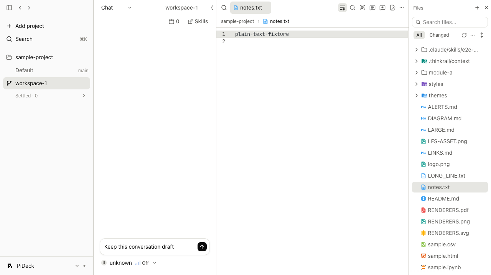

# PiDeck 文件工作台

## 范围与方向

以 PiDeck 的 Pi 宿主、typed wire、现有资源渲染器与本地 workbench 布局为基础，吸收 ZCode 的
文件树、路径工具栏、上下文菜单和聊天引用交互。保留现有十一类预览/审查渲染器、预览标签/固定标签、
分屏、Git 标记与评论，不引入第二套文件预览引擎或智能体运行时。视觉遵守 `design-system.md`。

用户已确认包含文件/目录的新建、重命名、移动；删除必须确认并走已有系统回收站，无永久删除兜底。

## 研究依据与差距

本地参考 ZCode 的 `packages/ui/src/workspace-file-tree/`、`PreviewPane.tsx`、
`components/ui/code-viewer.tsx`、`lib/codeCommentContext.ts` 和 `workspace-file-search/`。
重点是交互和职责分离，PiDeck 按自身边界实现，不移植 ZCode 的平台服务、全局事件体系或状态容器。

| 能力 | 改造前 | 集成方式 |
| --- | --- | --- |
| 多格式预览/源码高亮 | 已有 11 类 renderer；Monaco 源码只读 | 保留分发；增加显式编辑、保存和冲突反馈 |
| 源码查找/选择/评论 | Monaco 已有查找/定位/选择，评论已有锚点与草稿 | 显式工具入口，增加选区插入聊天 |
| 自动换行 | 已有全局行宽，但缺少文件操作入口 | 文件工具栏提供可见开关 |
| 文件树操作 | 已有展开/压缩链/Git 标记/跟随活动文件 | 加入统一右键/更多菜单、搜索、刷新和文件管理 |
| 文件路径 | 标签只显示 basename | 路径面包屑、相对/绝对路径复制、定位目录 |
| 外部打开 | 已有宿主 editor.list / workspace.openIn / reveal | 扩展到受约束的工作区内文件和目录 |
| 标签 | 已有预览/固定/重排/分屏与溢出搜索 | 保留布局，补齐常驻搜索及文件身份/编辑状态 |
| 与聊天交互 | Composer 只暴露替换整段草稿的 imperative handle | 原子插入到当前工作区最近选中或聚焦的聊天，保留草稿与光标；不自动发送 |
| 文件写入/删除 | fs 只提供读取；changes 已有 CAS，trash 已有跨平台实现 | 受控新增 fs 接口，复用路径 containment、hash 与 trash |

## 行为契约

- 新 API 有协议版本门禁；旧宿主继续可浏览，隐藏/禁用不可用的写入操作。
- 写入只接受工作区内 UTF-8 普通文本文件，以读取时的 hash 防止覆盖外部修改；保存原子替换，保留模式。
- 创建/移动不覆盖已有目标；工作区根、`.git` 与越界/不安全符号链接不能被修改。
- 未保存编辑与磁盘内容分开；切换标签/工作区保留草稿，关闭/重载有保护，冲突不得静默覆盖。
- 删除只走系统回收站。失败保留可恢复内容并报告，不转为永久删除。
- 搜索有结果/扫描边界和过期请求保护；无结果、加载、失败、截断均可区分。
- 文件/目录/选区插入当前工作区的目标聊天，保留已有草稿和插入点。无聊天时显式动作可创建空聊天；不得自动发消息。
- 文件操作、复制路径、聊天引用和查看渲染器共享路径身份；图标不改变文件类型判断或编辑权限。

## 实施与验收记录

- [x] 对照参考源码与现有模块，明确文件管理范围
- [x] 宿主文件管理/搜索/外部打开接口与安全回归
- [x] 编辑草稿、保存冲突和聊天光标插入状态
- [x] 文件树菜单、搜索、根操作与文件路径工具栏
- [x] 源码编辑、换行、查找/选区评论与添加到聊天
- [x] 标签搜索/编辑状态及关闭保护
- [x] 中英文及其他既有语言目录、模块规格和 README
- [x] 执行定向回归、一次完整无智能体浏览器套件与最终 diff 审查（结果见下方，整仓门禁未全绿）

Windows 真机验收仍待具备设备；浏览器仿真不等于原生验收。

## 使用与边界

- 在右侧「文件 → 全部」中搜索名称或相对路径，空格分隔多个关键词；默认遵循 Git ignore，可选择包含忽略项。
  搜索最多扫描 20,000 项、显示 200 个结果；达到边界会提示部分结果。它是文件路径搜索，不是全文搜索。
- 文件/目录右键和行末「更多」使用同一菜单。根菜单提供新建文件、目录及未保存草稿列表。
  F2 重命名；Delete 打开回收站确认，取消不会发送删除请求。新建/移动目标已存在时拒绝覆盖。
- 文件顶部显示可点击的目录路径，以及现有预览/源码切换。源码工具支持换行、查找、全选、选区评论和添加到聊天；重新开启换行时遵循现有行宽设置。
  「已改动」视图继续使用原来的 diff/revert/review 菜单，避免把历史路径误作可写文件。
- 默认只读预览；点击编辑后可修改 UTF-8 普通文本，单文件上限 8 MiB，Ctrl/Cmd+S 保存。
  显式保存保留 BOM、LF/CRLF 和普通权限模式；发生内容冲突时保留草稿，可另存为新路径。
  不提供自动覆盖、自动发送消息或批量永久删除。
- 未保存内容以工作区/路径为身份，在应用内切换标签和工作区时保留。当前窗口的 sessionStorage 支持刷新恢复；
  关闭窗口或应用后不保证保留，容量不足会提示，必须在关闭前保存。原生偏好接口不用于文件草稿，避免其小容量静默拒绝。
  文件被外部移动/删除后，可从根菜单的未保存列表重开缓冲区并另存。不同浏览器窗口分别保留草稿，磁盘 hash 防止过期保存。
- 编辑期间禁用针对磁盘版本的评论入口；保存并结束编辑后评论。未保存选区/文件插入聊天时带有未保存标记和实际文本，
  单次引用最多 32,000 字符。引用目标为同一工作区当前或最近选中的有效聊天；没有聊天才创建空聊天。
- 保留现有多格式预览、预览/固定标签、分屏、Git 标记与审查锚点。新协议为 v103；旧宿主保留浏览/引用，写入入口受版本门禁。
- 外部编辑器复用宿主 PATH 检测及启动能力，新增 Zed、Sublime Text、Cursor 候选；文件管理器按宿主系统定位文件。
  这里的宿主可能是远端机器，不把浏览器所在机器与宿主混为一谈。

## 减法审查

复用现有 Monaco、资源渲染器、workbench 布局、review 和 trash 实现，没有引入新编辑器、智能体运行时或运行时依赖。
文件管理集中在一个菜单与一个操作对话框；缓存和布局的移动投影共用纯路径规则。
草稿必须独立于磁盘缓存，否则文件监听刷新会覆盖未保存编辑；恢复存储必须按窗口隔离，否则两个窗口会覆盖彼此草稿。
Changed 的专用审查菜单、现有平台打开方式与文件预览分发有意保留。

## 界面证据

以下截图来自隔离示例项目，展示保持可见的聊天、右侧文件标签与工具栏、源码区和目录树；不包含用户真实项目内容。

<picture>
  <source media="(prefers-color-scheme: dark)" srcset=".github/readme-assets/pideck-files-dark.png">
  
</picture>

## 验证结果（2026-10-29）

| 检查 | 实际结果 |
| --- | --- |
| 新增文件工作台浏览器回归 | 11/11 通过，包含 CRUD、冲突、草稿恢复、多窗口、引用目标、删除确认与失败保留 |
| 最终相关浏览器复验 | 40 项通过；同行运行的聊天窄屏行宽用例仍因设置菜单入口超时失败 |
| 单元测试 | Web 2,017、资源渲染器 212、fs/watch/editors/contracts 定向 99 项通过；最后保存返回值/链接根搜索修改的 6 项 fs 回归再次通过 |
| 构建与快速门禁 | Web build、全仓 typecheck（24 个包）、deps、seams、boundaries、spec surface、i18n 通过；lint 无错误，保留已有大 HTML 文件警告 |
| React Compiler | 本次文件组件无新增 bailout；全仓仍有 LeftPeekPanel / useLeftPeek 两项已有未解决 bailout，未重写基线掩盖 |
| 一次完整无智能体套件 | 676 项：624 通过、52 未通过。随后 14 项原失败通过定向复验，另外 38 项本轮未修复；未声称全量通过 |
| 视觉 | 隔离样例的明/暗主题、路径工具栏、文件菜单、评论与图标已截图核对 |
| 未执行 | 本轮 macOS 原生产物/回收站真机、Windows 真机、完整真实模型套件；无真实模型调用 |

全量运行期间存在并行的聊天/标题栏/侧栏修改。文件行宽覆盖问题已修复；文件图标测试改为按目录 li 定位，
文件预览测试用支持的键盘关闭入口替代已移除的聊天关闭按钮，功能断言保留。其余失败涉及聊天、历史、
滚动、导航、终端等，不能把所有失败都归于或排除于本次改动；当前整仓尚未达到发布验收条件。

本地证据：`/tmp/pideck-workbench-full-e2e.log`、`/tmp/pideck-workbench-final-e2e.log`、
`/tmp/pideck-workbench-icons-e2e.log` 和 `/tmp/pideck-workbench-unresolved-e2e.txt`。
本轮未提交、推送或发布；保留同一工作区其他任务已有的暂存和未提交内容。

## 右侧工作台与交互细节

文件、文件差异与改动审查打开在右侧统一工作台，包含资源标签、查看/编辑区与目录树；主聊天区保持可见。
文件操作进入标签栏，下面的面包屑仅展示路径。外侧分隔条调整整个右侧区域，内部可调整文件与目录树的比例。
隐藏文件工具保留标签与草稿；重新展开、刷新和工作区切换继续复用既有布局持久化。
文件行和更多按钮共享 hover 背景，相邻行保留 2px 空隙；右键菜单随指针定位，并在窗口边缘自动避让。
源码菜单复用应用圆角/阴影；Monaco 首次加载时使用当前应用语言的官方内置语言资源，已加载后的语言切换需刷新。
查找关闭按钮与其他按钮对齐，取消其 hover 提示而保留可访问性名称；文件工具栏提示向下显示。

## 细节与布局补充验收（2026-10-29）

- 文件行整行 hover、行间距、右键指针定位、更多按钮、Monaco 中文菜单和关闭按钮无 tooltip 已通过浏览器回归。
- 文件、diff 与 Changes 审查均进入右侧资源区，工具按钮位于标签栏；聊天保留。文件区显示/隐藏、刷新、新建聊天和差异打开已通过验证。Specs 可作为右侧导航继续显示，不被文件打开操作意外隐藏。
- 文件/评论/审查组合回归 69 项中 67 项首轮通过，另外两项把全局“活动标签”误当成唯一资源标签；改为定位右侧工作台后，两项均复验通过，未删减内容或锚点断言。另一次文件、预览、Specs 与主题组合 35 项通过；最终文件与多格式预览组合 14 项通过。
- 完整无智能体套件执行一次：681 项中 596 通过、85 未通过。后续修复了本次发现的面板定位、导航与聚焦问题，并完成上述定向复验；未再次运行整仓套件，不把结果描述成整仓全绿。全量日志 `/tmp/pideck-dock-full.log` 与失败清单 `/tmp/pideck-dock-failures.txt` 保留。
- Web 单测 2,026、UI 单测 56、资源渲染器单测 212 通过；类型检查 24 包通过，Web build、lint、i18n、边界与 spec surface 通过。React Compiler 仍有此前的 LeftPeekPanel/useLeftPeek 两项 bailout，未修改基线或添加抑制。
- 未进行本轮原生 macOS/Windows 真机验收，未提交或推送。Monaco 在首次加载时固定其内置语言，切换应用语言后刷新页面即可统一菜单和查找文案。
